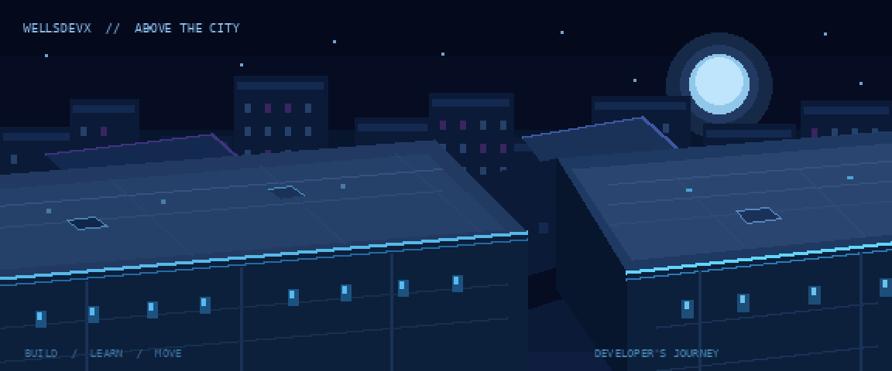

### Build. Learn. Explore.

**Tecnologia • Desenvolvimento • Suporte Técnico**

Estudante de Análise e Desenvolvimento de Sistemas, transformando aprendizado em projetos e explorando novas possibilidades na tecnologia.

---

## Sobre mim

Fala! Sou o **Welder**, estudante de Análise e Desenvolvimento de Sistemas.

Gosto de tecnologia, de entender como as coisas funcionam e de criar projetos que me desafiem. Tenho experiência com suporte técnico e ensino de informática e estou desenvolvendo minhas habilidades em programação, desenvolvimento web e banco de dados.

Também gosto muito de jogos, principalmente aqueles que oferecem liberdade de movimentação e exploração. **Assassin's Creed** é uma das minhas maiores referências, especialmente pelas mecânicas de parkour e stealth. Também curto Marvel's Spider-Man, Bully: Scholarship Edition, Hogwarts Legacy, dentre outros.

Essas referências influenciam minha vontade de desenvolver minhas próprias experiências.

## Tecnologias e ferramentas

**Desenvolvimento web:** HTML5 e CSS3.

**Ferramentas:** Git, GitHub e Visual Studio Code.

**Em aprendizado:** programação, banco de dados, SQL e desenvolvimento de sistemas.

Também tenho interesse em **Linux, segurança da informação e desenvolvimento de jogos**.

---

## Projeto em destaque

### Atlas — Explore o Mundo

**Uma experiência de exploração cultural desenvolvida em equipe.**

O Atlas é um projeto acadêmico de desenvolvimento Front-End que reúne informações sobre dez países, abordando diferentes temas culturais, históricos e geográficos.

O site utiliza HTML e CSS, com uma identidade visual compartilhada e páginas organizadas por país.

**Minha participação:** desenvolvimento da página inicial, organização da estrutura, navegação entre páginas e integração visual do projeto.

O Atlas continua recebendo atualizações conforme as etapas acadêmicas são concluídas.

## Outros projetos

| Projeto | Descrição | Situação |
| :--- | :--- | :--- |
| **UPSkill** | Projeto acadêmico de modelagem de banco de dados para gestão educacional | Em desenvolvimento |
| **Snapline** | Projeto pessoal no Roblox com foco em parkour, movimentação e stealth | Protótipo |

---

## Áreas que estou explorando

<b>01 — Desenvolvimento web</b>

HTML, CSS, estrutura semântica, navegação, layouts e interfaces responsivas.

<b>02 — Banco de dados</b>

Modelagem conceitual, DER, relacionamentos, chaves primárias e estrangeiras e fundamentos de SQL.

<b>03 — Suporte técnico</b>

Hardware, manutenção, sistemas operacionais e resolução de problemas técnicos.

<b>04 — Desenvolvimento de jogos</b>

Roblox Studio, movimentação de personagens, parkour, câmera, mecânicas de jogo e prototipagem.

---

## Minha jornada

- [x] Criar meu perfil no GitHub
- [x] Começar meus projetos acadêmicos
- [x] Publicar a primeira versão online do Atlas
- [x] Organizar minha apresentação profissional no GitHub
- [ ] Publicar o Atlas completo
- [ ] Documentar minha participação no UPSkill
- [ ] Documentar uma versão jogável do Snapline
- [ ] Continuar expandindo meu portfólio

---

### Every journey begins somewhere.

**BUILD. LEARN. LEVEL UP.**

*Um projeto de cada vez.*

[Ver primeira versão do meu perfil](https://github.com/wellsdevx/perfil-antigo)

